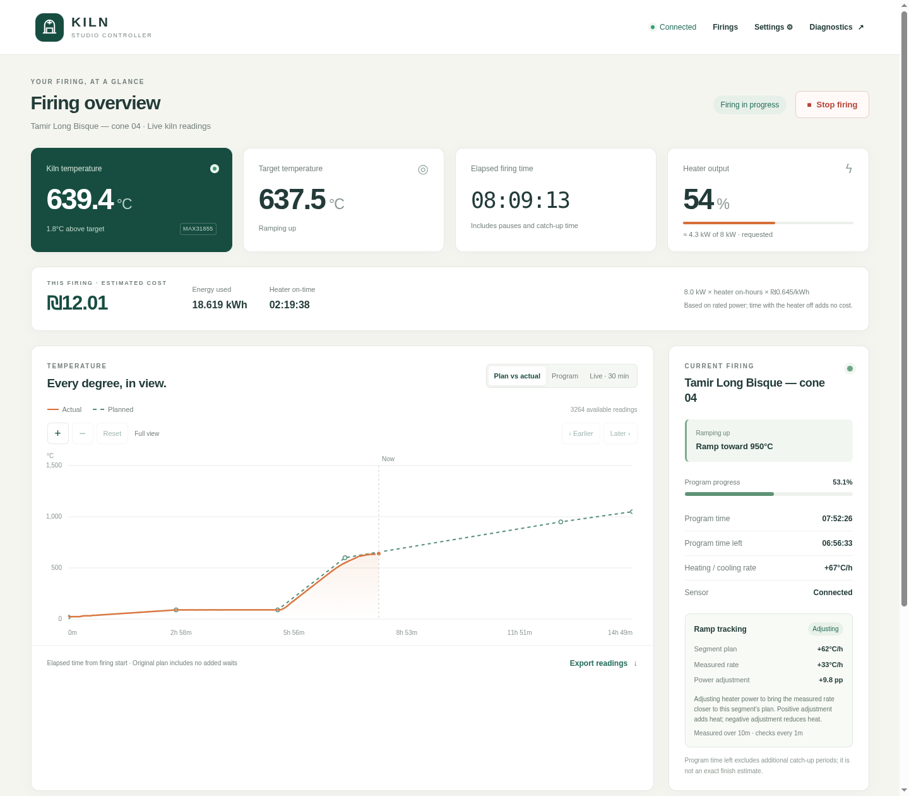
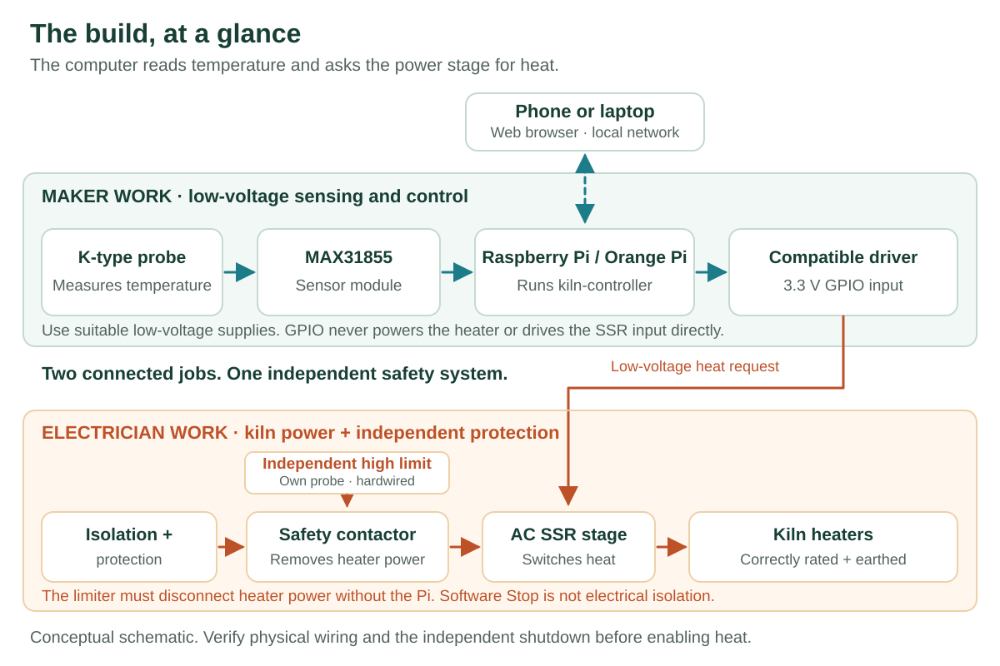
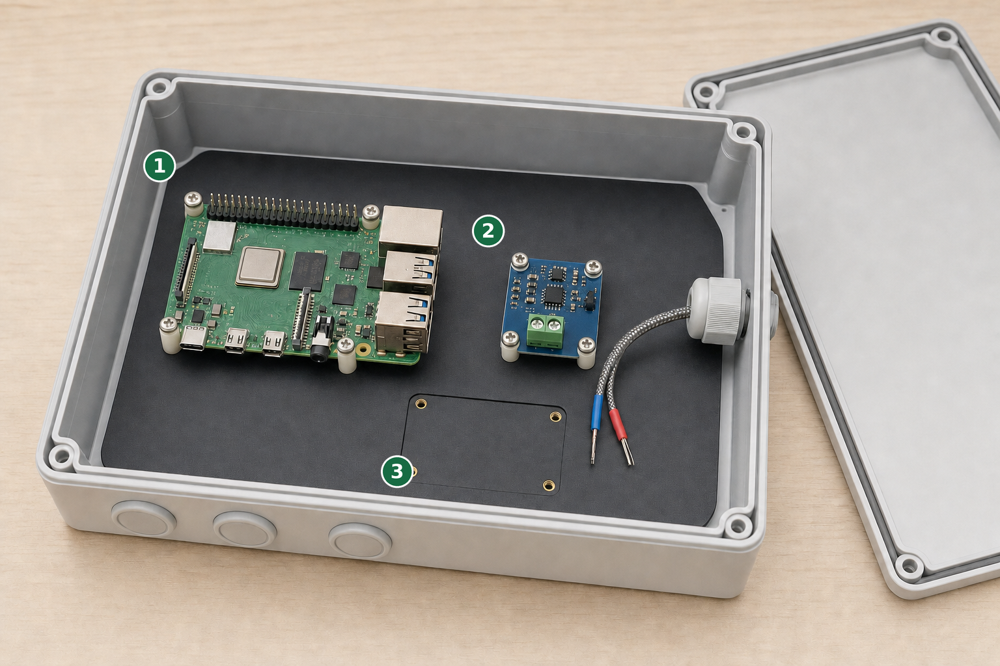

# Kiln Controller

Build a controller for your electric kiln and follow each firing from your phone
or computer. Create heating schedules, watch the temperature, keep firing records,
and estimate electricity costs—all from a browser on your local network.

[Build it](#build-your-controller) · [Parts](#what-you-need) ·
[Board options](#which-boards-can-i-use) · [Using your kiln](#make-a-program-follow-it-learn-from-it) ·
[Advanced guides](#go-further)

*A real firing on the Orange Pi Zero 2W build, captured 15 October 2026.
The solid curve is measured temperature; the dashed curve is the original plan.
Readings and settings belong to this installation.*

- **Make a firing program:** choose heating rates, temperatures and holds.
- **Follow it live:** compare the plan with what the kiln actually does.
- **Keep your results:** saved firing curves and records survive restarts.
- **Understand running costs:** estimate energy and cost from heater on-time.

## Start here

**New to the project?** [Try the dashboard in simulation](docs/GETTING-STARTED.md#try-it-before-buying-parts)
on a Linux computer first. No kiln, sensor or GPIO hardware is needed.

**Ready to build?** Choose one guide and use its matching pin diagram:

| Your route | Start here | Status |
| --- | --- | --- |
| Raspberry Pi 3 / 4 | [Illustrated Raspberry Pi build](docs/builds/raspberry-pi.md) | Software profile and setup path; physical commissioning still required |
| Orange Pi Zero 2W | [Orange Pi installation](docs/INSTALL.md) + [wiring](docs/HARDWARE.md) | Documented deployment on Debian 12 / Python 3.11 |
| Another board | [Compatibility and porting](docs/supported-boards.md) | Check the exact model; shared header shape is not proof of compatibility |

The Raspberry Pi guide is the intended beginner route. It has **not yet been
validated on a physical Raspberry Pi**. If you need to follow the existing
hardware example, choose Orange Pi Zero 2W. Other Raspberry Pi models are listed
separately in the compatibility guide.

> You can assemble and test the low-voltage controller first. Kiln mains wiring
> and the independent over-temperature cutoff require a qualified electrician.
> Keep kiln mains isolated during setup and output checks.

## How it fits together

The small computer reads the temperature and **asks for heat**. A suitable driver
and solid-state relay (SSR) switch the kiln power. An independent temperature
limiter can disconnect the kiln even if the computer or SSR fails.

The controller provides **one heat request**. A suitable single-phase or
three-phase power stage can use it; it does not independently control several
temperature zones.

## What you need

Choose the board first, then follow the [complete parts and tools list](docs/PARTS.md).

| Part | Quantity | What it does |
| --- | ---: | --- |
| Raspberry Pi 3/4 or Orange Pi Zero 2W | 1 | Runs the controller and serves the web interface |
| Correct board power supply + microSD | 1 each | Powers the board and stores the software |
| MAX31855 module + suitable ungrounded K-type thermocouple | 1 each | Measures kiln temperature |
| Compatible 3.3 V output driver/interface | 1 | Connects the small GPIO signal to the SSR's control input |
| Connectors, low-voltage wire, enclosure and mounting | As needed | Makes a secure controller assembly |
| Computer with an SD reader and local network | Existing equipment | Prepares the board and opens the dashboard |
| SSR, cooling and independent kiln protection | Kiln-specific | Selected and installed by the electrician |

MAX31856 and other thermocouple types are [sensor alternatives](docs/PARTS.md#sensor-alternatives).
The driver's exact part and polarity must match its guide. An SSR's input-voltage
label alone does not mean it can be driven directly from GPIO.

## Build your controller

Follow the [getting-started guide](docs/GETTING-STARTED.md) for the full sequence.
Each board guide keeps the wiring, software profile and commands together.

*Generated assembly illustration: arrange and secure the parts before wiring.
The empty mounting area is for your chosen output interface. Follow the
[Pi guide's pin tables and wiring diagram](docs/builds/raspberry-pi.md#3-connect-the-low-voltage-parts)
for connections.*

**1** Raspberry Pi · **2** Sensor converter · **3** Space for the output interface.

1. **Prepare the SD card and network.** Flash the recommended OS, create your
   account, connect the board and find its address. **Check:** you can log in.
2. **Install and preview.** Run the setup for your chosen board and open
   simulation. **Check:** the dashboard identifies simulated readings.
3. **Assemble the low-voltage controller.** Disconnect power and follow the
   board-specific sensor and output diagrams. **Check:** every pin matches.
4. **Check sensing and output with kiln mains isolated.** Verify temperature,
   polarity, faults and output-off behavior. **Check:** loss of controller power
   cannot leave a heat request active.
5. **Complete the kiln power installation.** Have the electrician verify
   switching, protection, earthing and independent shutdown for your kiln.
6. **Commission a first firing.** Set kiln-specific limits, power and tariff,
   then perform a supervised commissioning run. **Check:** review the saved curve.

Your chosen modules may need soldered headers; the parts guide identifies that
choice before you buy. Build time and total cost depend on your kiln and parts.

## Which boards can I use?

Board support is more than a GPIO library recognizing a name. It needs a matching
OS, pin map, installer, output driver and physical commissioning checks.

| Board family | What to expect |
| --- | --- |
| **Orange Pi Zero 2W** | Existing documented deployment |
| **Raspberry Pi 3 / 4** | New software profile; hardware verification is pending |
| Other Raspberry Pi / Orange Pi | Model-specific work and validation; Pi 5 is not covered by the Pi 3/4 profile |
| Banana Pi, NanoPi, ODROID, Radxa / Rock Pi | Potential ports; not tested builds of this fork |
| BeagleBone, Pine64, Libre Computer, Khadas | Potential ports; not tested builds of this fork |
| Jetson, Coral and other Linux boards | Advanced candidates in the full inventory |
| Linux computer / VM | Hardware-free simulation; real GPIO through a bridge is experimental |
| Arduino, ESP32, Raspberry Pi Pico | Not standalone replacements for this Linux/Python application |

The [complete compatibility guide](docs/supported-boards.md) preserves the
inherited model inventory, covers USB/GPIO bridges, and explains how to submit a
verified build. A listed alternative is not a promise of working support.

## Make a program. Follow it. Learn from it.

**Create a schedule.** A *ramp* changes temperature over time; a *hold* keeps the
same temperature. Enter cumulative times and target temperatures, review the
curve, then save. Use a program suitable for your kiln, load and material.

**Follow the firing.** Watch actual and target temperature, progress, requested
heater output and estimated cost. The kiln continues running if your browser
disconnects. “Time left” is program time, not an exact finish-time prediction.

**Review the result.** Open the firing history to compare curves and inspect
duration, peak temperature, energy and cost. Export available data as CSV or JSON.

*Editor and history images are from the October 2026 installation. Energy and
cost are estimates based on installed power and output on-time, not a mains meter.*

The [user guide](docs/USER-GUIDE.md) explains programs, chart controls, phone use,
history and exports. [Settings](docs/SETTINGS.md) explains the review-and-save
workflow. Keep the controller on a trusted local network: the current server has
no login and should not be exposed directly to the Internet.

## Go further

| Guide | Use it for |
| --- | --- |
| [Hardware and power](docs/HARDWARE.md) | Sensor wiring, driver interface, mains/safety concepts |
| [Control and recovery](docs/CONTROL.md) | Catch-up, warm starts, PID behavior and restart conditions |
| [PID tuning](docs/pid_tuning.md) · [Automatic ramp correction](docs/automatic-ramp-control.md) | Matching control behavior to your kiln |
| [API](docs/api.md) | Integrations and diagnostics |
| [Maintenance](docs/MAINTENANCE.md) | Backups, updates, service management and records |
| [Development and board ports](docs/DEVELOPMENT.md) | Simulation, tests and adding hardware profiles |
| [Troubleshooting](docs/troubleshooting.md) | Investigating common problems |

## Help and contributions

Found a documentation gap? [Open an issue](https://github.com/tamirgold/kiln-controller/issues)
with the step you reached, your board/OS and the error text. For a new board,
include the [build-validation details](docs/supported-boards.md) so other makers
can reproduce it. Keep credentials out of reports.

## Project history and license

Based on [jbruce12000/kiln-controller](https://github.com/jbruce12000/kiln-controller),
which originated from [apollo-ng/picoReflow](https://github.com/apollo-ng/picoReflow).
This fork adds the interface, Orange Pi deployment, durable history, energy
estimates, settings and control improvements described in the guides.

Licensed under **GNU GPL version 3 or later**; see [LICENSE](docs/LICENSE.md).
Provided without warranty. Dated installation values are preserved in the
[installation example](docs/INSTALLATION-EXAMPLE.md); use your own kiln's ratings
and validated configuration.
