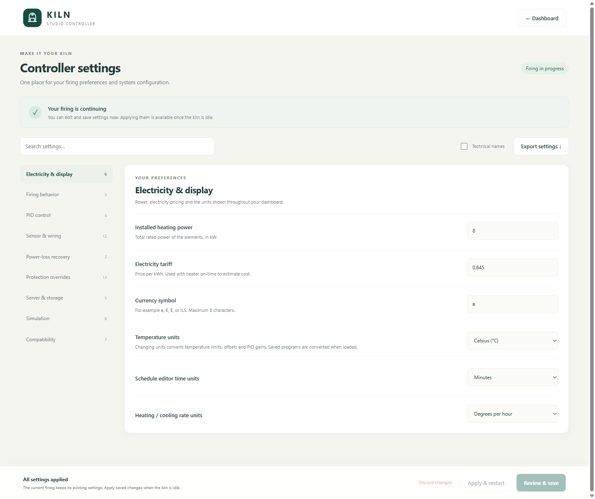
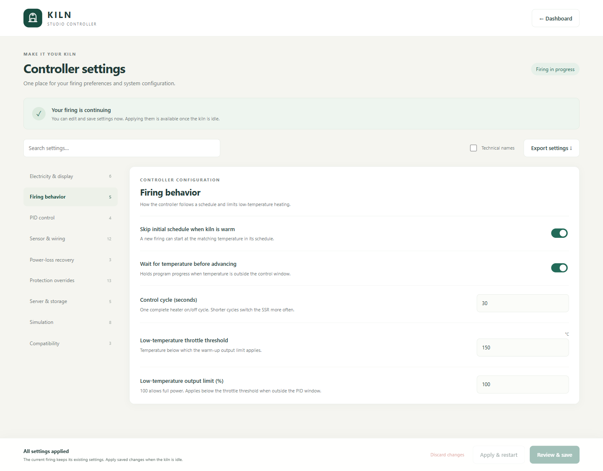
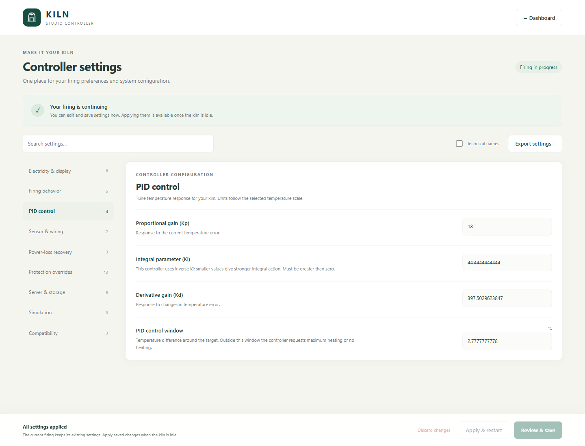
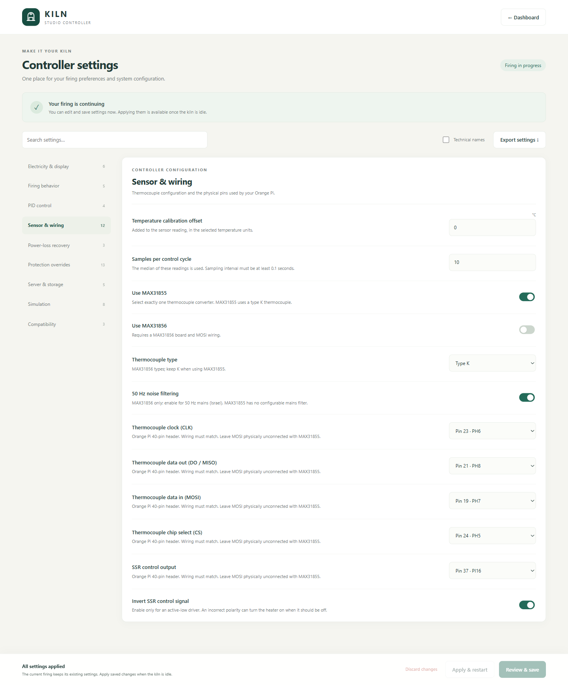
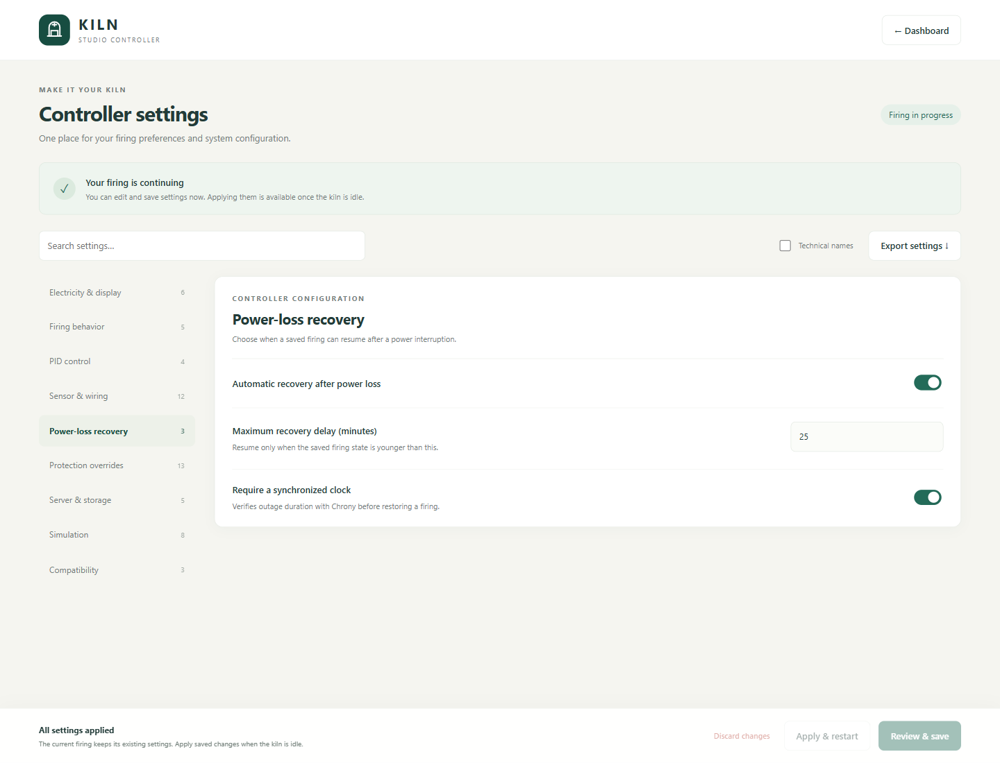
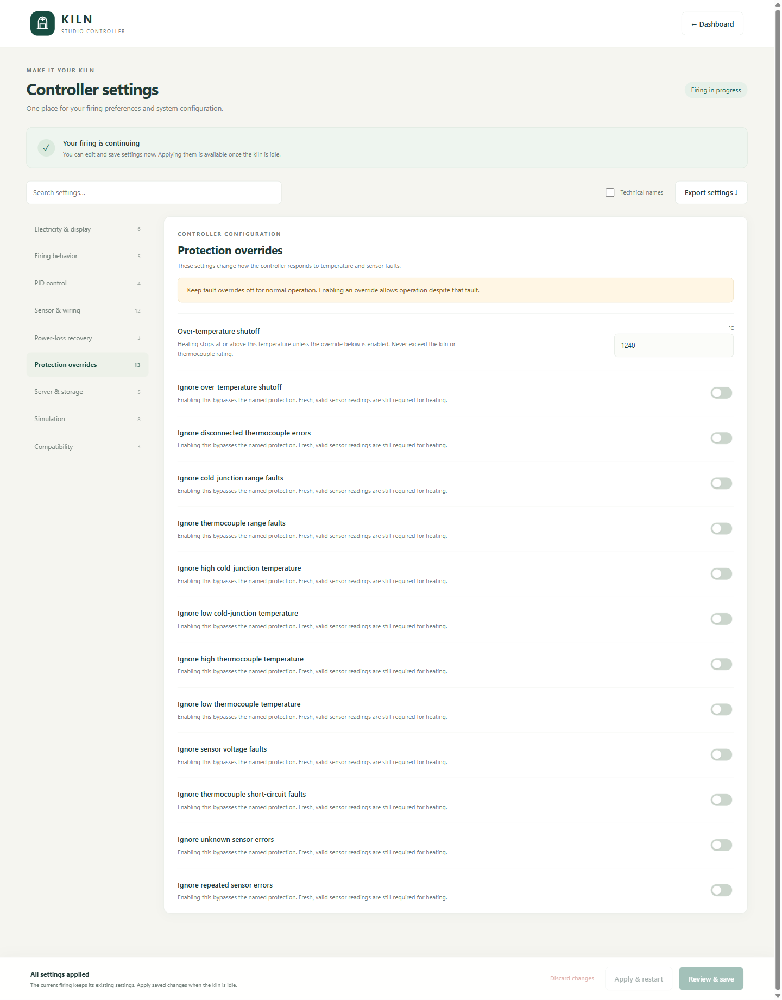
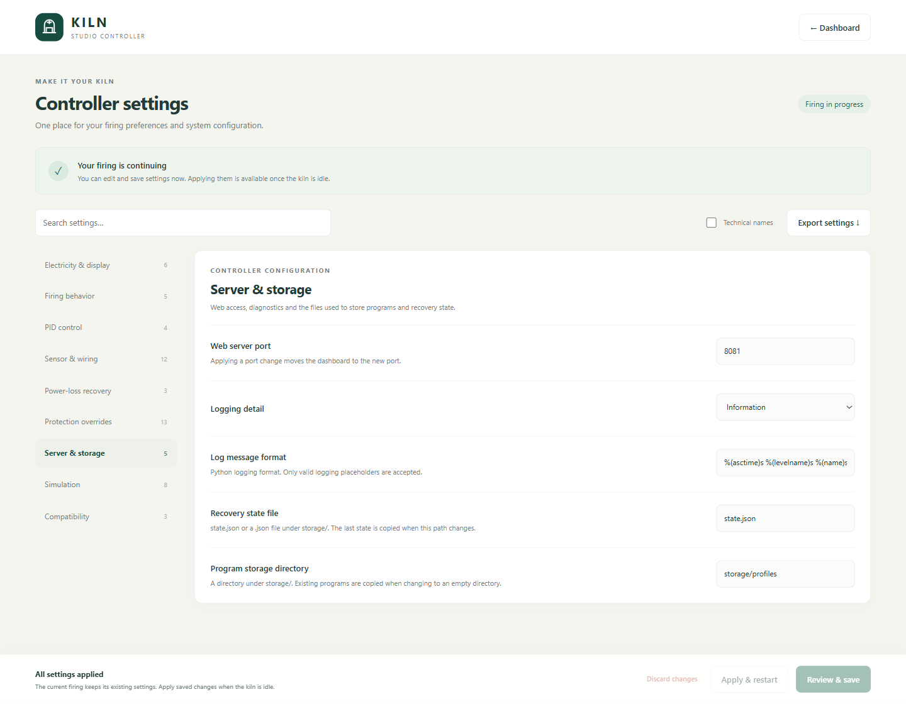
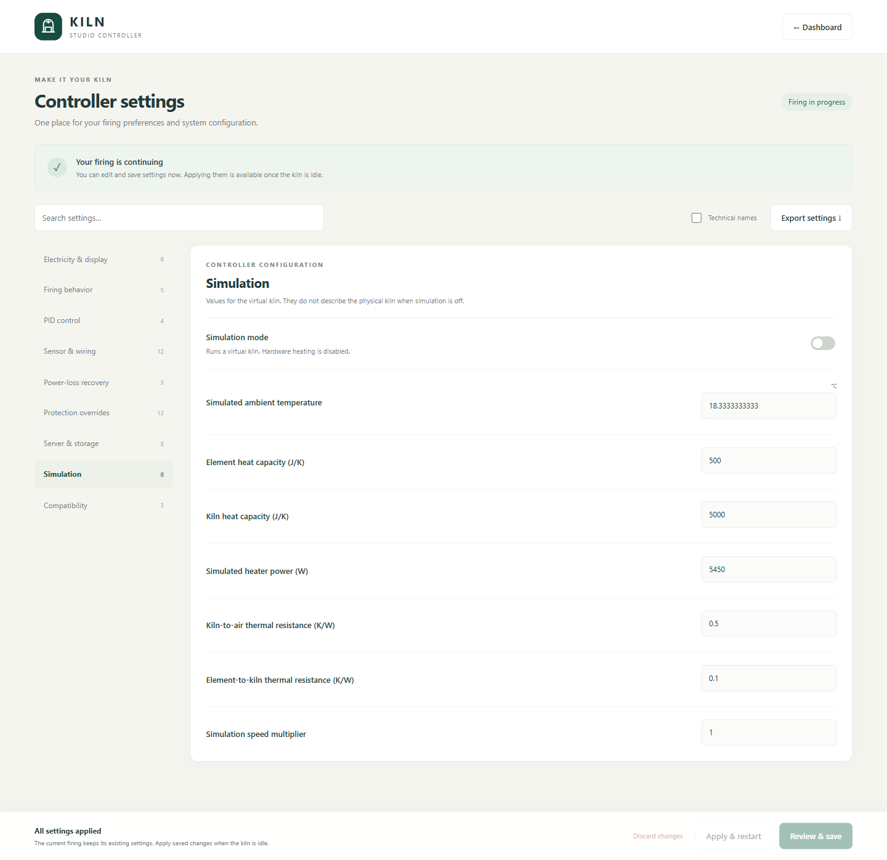
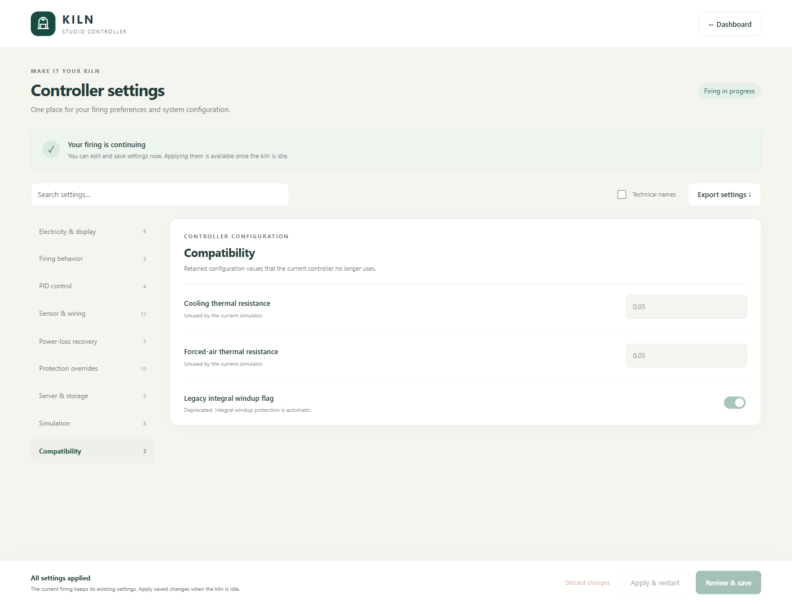

# Settings

Open **Settings** from the controller, or use
`http://your-board.local:8081/picoreflow/settings.html` with your board's hostname
or IP address and configured port. Search across categories, show technical
names when needed, and export a JSON copy for reference.

Settings describe your actual kiln, sensor and output interface. Begin with the
matching [build guide](GETTING-STARTED.md); the
[documented Orange Pi installation](INSTALL.md) and
[Raspberry Pi build guide](builds/raspberry-pi.md) have different board requirements.

## Save and apply changes

1. Edit values in any category, then choose **Review & save** to inspect the
   before/after values. Saving creates pending settings and leaves the running
   firing unchanged.
2. When the kiln is idle with no eligible recovery waiting, choose
   **Apply & restart**. The controller backs up the current settings, activates
   the saved values and restarts through systemd. A directly launched process
   must be relaunched manually.
3. Use **Discard changes** to discard the local draft, or review discarding
   pending settings. Concurrent-editor checks prevent silently overwriting
   another session's changes.

Applied overrides are stored in `settings.json`; pending values are stored in
`settings.pending.json`. Both are local files excluded from Git. A settings
snapshot is saved before each apply. See [data and backups](MAINTENANCE.md).

Changing Celsius/Fahrenheit in the UI converts temperature limits, offsets,
the PID window and PID gains. Programs are converted when loaded. Validation
checks sensor selection, distinct GPIO pins, sampling intervals, limits and
storage paths. Pin choices follow the selected hardware profile; use the
physical wiring diagram for that exact board.

Environment-selected mode, port and recovery path appear locked in Settings.
Other service-enforced fields can also be read-only. The three legacy
compatibility values are read-only because they no longer control active
features. See [configuration sources](MAINTENANCE.md#configuration-sources).

## What each category controls

| Category | What it controls | Start here |
| --- | --- | --- |
| Electricity & display | Installed power, tariff, currency, temperature/time/rate units | Match your kiln rating, energy tariff and preferred display units |
| Firing behavior | Warm-start seek, catch-up and tolerance, automatic ramp correction, cycle length, low-temperature throttle | Match the output driver and intended firing behavior |
| PID control | Kp, inverse Ki, Kd, control window | Tune for the actual kiln and control cycle |
| Sensor & wiring | Calibration, sampling, converter/type/filter, GPIO pins, polarity | Match the exact board, sensor and output interface |
| Power-loss recovery | Enable recovery, maximum delay, clock synchronization | Decide whether an interrupted firing may resume automatically |
| Protection overrides | Temperature limit and individual fault overrides | Set an appropriate limit and keep fault overrides disabled for normal use |
| Server & storage | Port, logging level/format, recovery file, program directory | Change only when your installation needs different network or storage paths |
| Simulation | Mode, ambient temperature, thermal model, speed multiplier | Explore programs without using real heating |
| Compatibility | Unused cooling/airflow parameters and deprecated windup flag | Read-only legacy values |

Read [control and recovery](CONTROL.md) before changing PID, catch-up, ramp
correction or recovery settings. Installed heating power is used for estimates;
it does not set the electrical power of the kiln. A software temperature limit
does not replace the independent high-limit circuit in the
[hardware guide](HARDWARE.md).

## Screenshots by category

These screenshots were retained from the installation documented on
**4 October 2026**. They illustrate the categories and are not recommended
settings for another kiln. The current interface may include later changes.
See the [dated installation example](INSTALLATION-EXAMPLE.md).

Firing behavior

PID control

Sensor & wiring

Power-loss recovery

Protection overrides

Server & storage

Simulation

Compatibility

