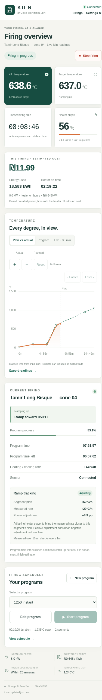
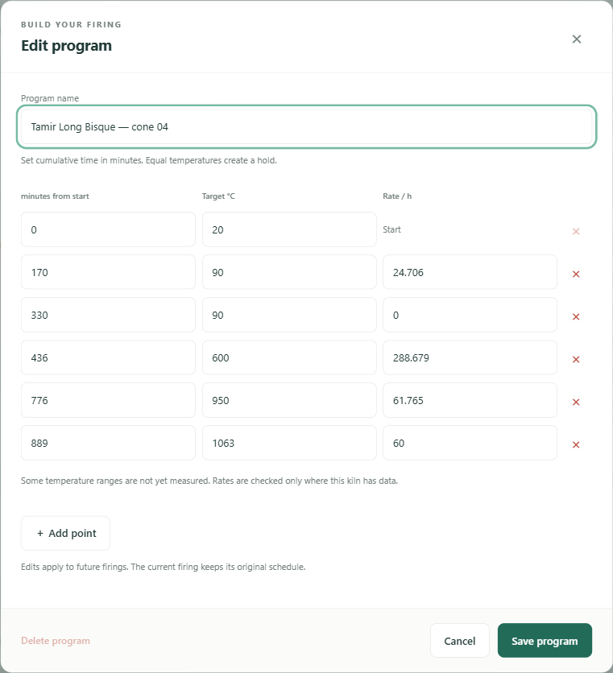
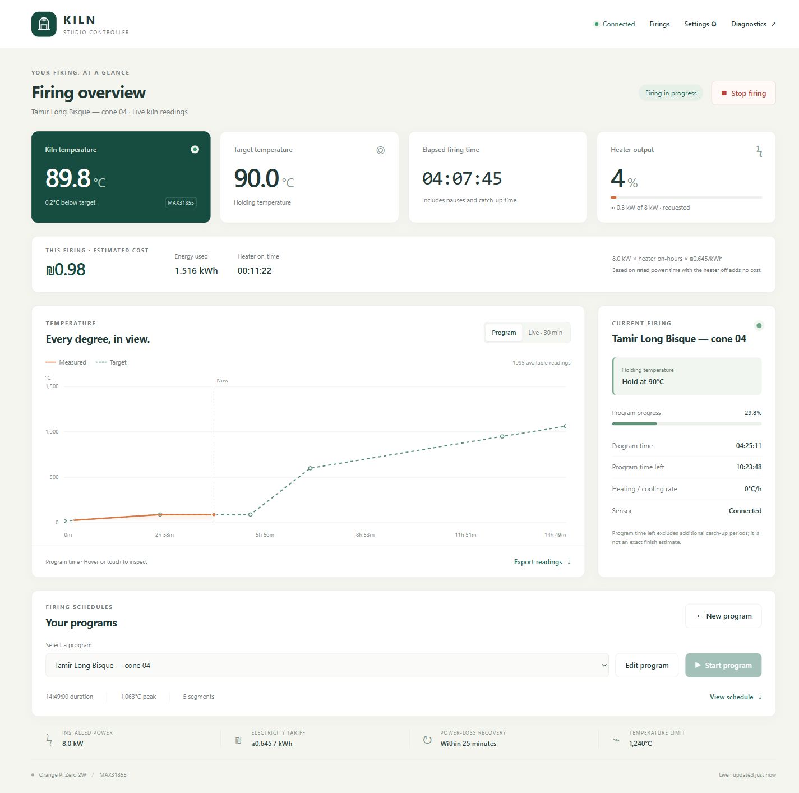
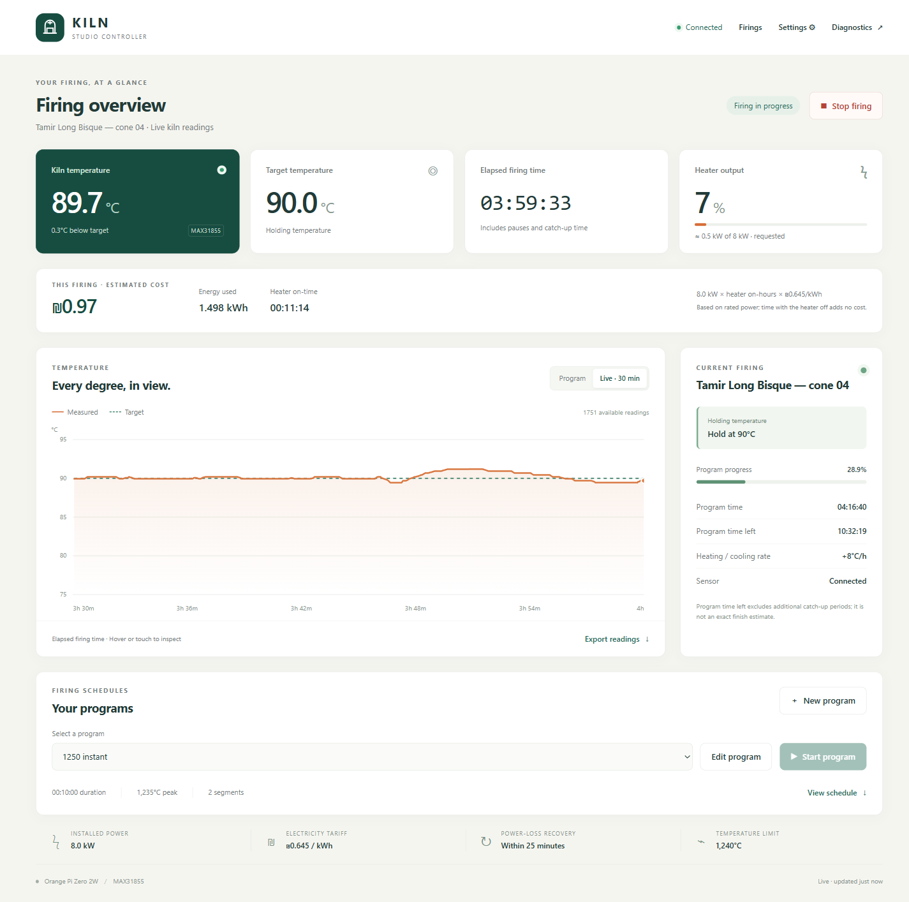
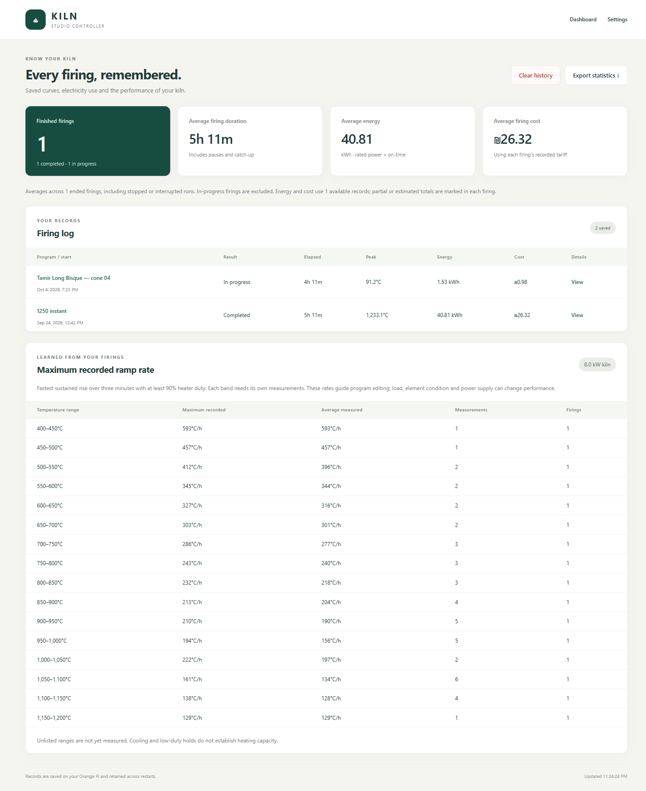
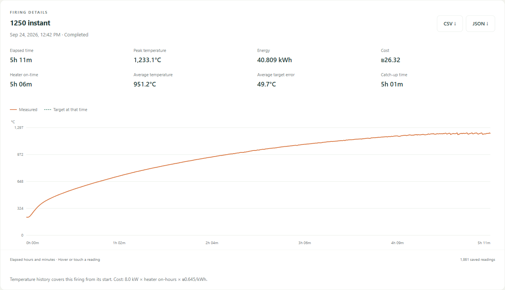

# Using your kiln controller

Create a firing program, follow its temperature curve, and keep a record of the
result from a browser on your local network. Complete the [build and
commissioning guide](GETTING-STARTED.md) before using real heating.

[Open the controller](#open-the-controller) · [Programs](#create-and-run-a-program) ·
[Dashboard](#read-the-dashboard) · [Energy](#electricity-and-energy) ·
[History](#firing-history) · [Settings](SETTINGS.md)

Unless labeled otherwise, screenshots on this page come from the Orange Pi
installation documented on **4 October 2026**. Their readings and settings are examples, not values to
copy into a different kiln. See the [installation record](INSTALLATION-EXAMPLE.md).

## Open the controller

Open your board's address on the same local network, for example
`http://your-board.local:8081/`. Replace `your-board.local` with the hostname
chosen during installation, or use the board's IP address if `.local` does not
resolve. Use your configured port if it differs from 8081.

| Page | Address path | What it is for |
| --- | --- | --- |
| Dashboard | `/picoreflow/index.html` | Programs and the current firing |
| History | `/picoreflow/history.html` | Saved firings, statistics and exports |
| Settings | `/picoreflow/settings.html` | Review and change controller settings |
| Diagnostics | `/state` | Advanced temperature and PID plots |

The root address redirects to the dashboard. The server has no user login or
TLS; keep it on a trusted local network and do not expose its port directly to
the Internet.

See the dashboard on a phone

This phone-width capture is from **15 October 2026**. The same browser interface
adapts to the smaller screen; there is no separate phone application to install.

## Create and run a program

A **ramp** changes the target temperature over time. A **hold** keeps the target
temperature steady. Program times are cumulative: a point at two hours means
two hours from the beginning of the schedule, not two hours after the previous
point.

1. Choose **New program**, or select an existing program and choose **Edit program**.
2. Give it a name and enter cumulative times and target temperatures. Start at
   time zero and use increasing times. Two consecutive equal temperatures create
   a hold.
3. Enter a ramp rate to calculate that segment's duration and shift later points.
   Heating rates are positive and cooling rates are negative. Set hold duration
   with time.
4. Review the curve, total duration, peak temperature and schedule table, then save.
5. With a commissioned kiln, a ready sensor and an idle controller, choose
   **Start program**. Confirm the program, scheduled duration and peak.
6. To end a firing, choose **Stop firing**. This switches the heat request off
   and cancels automatic recovery of that firing. Cooling is passive.

The editor supports seconds, minutes or hours and configurable rate units.
Targets cannot exceed the configured temperature limit. Choose a schedule
appropriate to your kiln, load and material; a saved example is not a universal
first-firing program.

Saved heating-capacity measurements warn about ambitious ramps without
preventing a save. Temperature ranges without measurements are identified
separately. See [heating-capacity measurements](#learn-the-kilns-heating-capacity).

You can add and remove points, save changes and delete unused programs. Edits
to an active program apply to future firings: the current firing keeps its
original schedule, and its program cannot be deleted in the editor. Changing
a program's name saves another program and leaves the original available.

**Stop firing is not electrical isolation.** An SSR can fail closed; use the
independent shutdown circuit and the isolator described in the
[hardware guide](HARDWARE.md). Restarting the controller service is also
different from Stop firing: an eligible firing may recover after a restart.
See [power-loss recovery](CONTROL.md#power-loss-recovery).

## Read the dashboard

The dashboard shows measured and target temperature, requested heater duty,
approximate kW, sensor status, heating/cooling rate, and the current ramp, hold
or cooling phase. Heater duty is the percentage of each control cycle during
which heat is requested; it does not prove that the elements are energized.

Elapsed firing time includes pauses and catch-up. Program progress follows the
schedule, so the displayed time left is not an exact finish-time prediction.
Read [control behavior](CONTROL.md) for catch-up and warm starts.

### Choose a chart view

| View | What it shows |
| --- | --- |
| **Plan vs actual** | The original schedule and measured temperatures on the same elapsed-time axis |
| **Program** | Program progress |
| **Live · 30 min** | Recent readings and the controller's target |

For a warm start, Plan vs actual puts the saved starting program position at
zero and focuses on actual readings and the remaining plan. A start summary
shows the starting temperature and skipped duration. **Show skipped steps**
reveals earlier program points at negative times; remaining steps stay positive.
The offset stays fixed through catch-up and recovery. Comparison is unavailable
if the original starting position is missing from the firing's saved readings.

Inspect points with a mouse, touch or arrow keys, and export available readings
as CSV.

Live · 30 min view

### Zoom and move the chart

- Use **+** and **−** to zoom, **Earlier** and **Later** to move, and **Reset**
  to restore the full view. You can drag the chart while zoomed.
- Ctrl+scroll zooms around the pointer.
- Keyboard shortcuts on the chart: +/− to zoom, Shift+Left/Right to move, and
  0 to reset.

A zoomed view keeps its time window as readings arrive. The temperature axis
fits the visible window.

### Connections and saved readings

The browser reconnects automatically after a lost connection. The controller
keeps operating; connection and sensor warnings identify unavailable readings.
Closing the browser does not stop a firing.

Reopening the dashboard restores the current firing's saved curve. Live status
updates at least every two seconds under normal operation. Long browser curves
are down-sampled for display while durable history retains its saved samples.

## Electricity and energy

The dashboard shows the current firing's estimated cost, energy and heater
on-time, then its final totals when the kiln becomes idle.

**Energy (kWh) = installed power (kW) × heater on-hours**

**Cost = energy × electricity tariff**

For the 8 kW kiln recorded on 4 October 2026, one hour of heater on-time costs
**₪5.16** at ₪0.645/kWh. Enter your own installed power, tariff and currency in
[Settings](SETTINGS.md). Off-time adds no energy; an hour of elapsed firing
time can contain many off periods.

Accounting follows actual controller-output on-time, including a pulse in
progress, and preserves totals across eligible recovery. This is a rated-power
estimate, not a mains meter. Heater percentage is the final commanded duty,
including any ramp correction, not confirmation that the output hardware or
heating elements are energized. Partial totals and earlier values reconstructed
from logs are labeled explicitly.

## Firing history

Each firing retains its program snapshot, measured/target curve, result,
duration, peak temperature, heater on-time, energy and cost. Records survive
controller restarts; an eligible recovery continues the same firing record.

- Summary averages cover **ended firings**, including stopped and interrupted
  runs. Running and paused firings are excluded. Costs keep currencies separate.
- Open a record for its curve, average temperature, average target error,
  catch-up time, sample count and data-quality notes. Gaps remain visible and
  are excluded from temperature averages and heating-capacity measurements.
- Export the statistics overview as JSON or an individual firing as JSON or
  CSV. History CSV temperatures are stored in Celsius regardless of display units.
- **Clear history** reviews and removes ended records and recalculates
  statistics. Saved programs and running/paused firings are kept. Export records
  before clearing.
- Real and simulated firings have separate archives and statistics.

### Learn the kiln's heating capacity

History measures the fastest sustained three-minute rise at at least 90% heater
duty within each 50°C band. It excludes cooling, low-power holds, interrupted
readings and unsuitable samples. Measurements from matching installed power
feed the program editor's ramp warnings.

These are observed capabilities, not guaranteed limits: load, element condition
and supply voltage affect performance. Ranges without qualifying measurements
remain unknown. This feature guides program editing; it does not automatically
retune PID gains or rewrite schedules.

## Next steps

- [Settings](SETTINGS.md): review, save and apply changes.
- [Control and recovery](CONTROL.md): sensors, PID, catch-up and restart behavior.
- [Maintenance](MAINTENANCE.md): backups, updates and routine checks.
- [API and diagnostics](api.md): advanced integration and diagnostic views.
