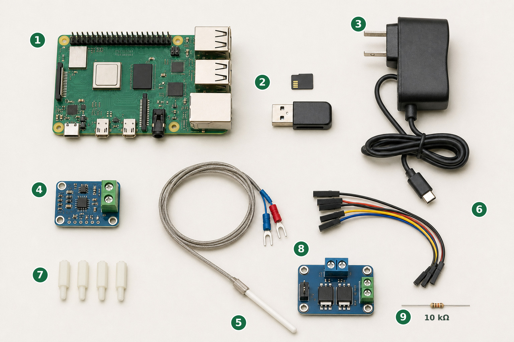
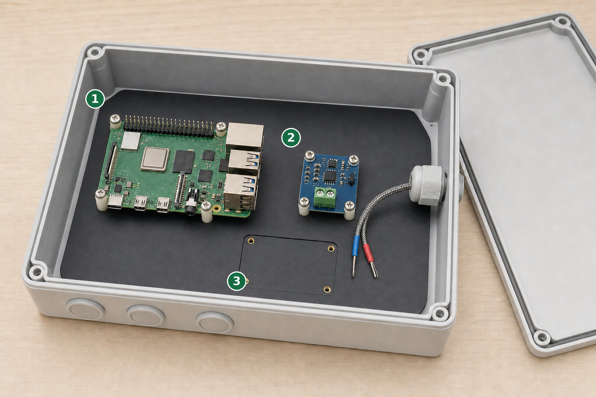
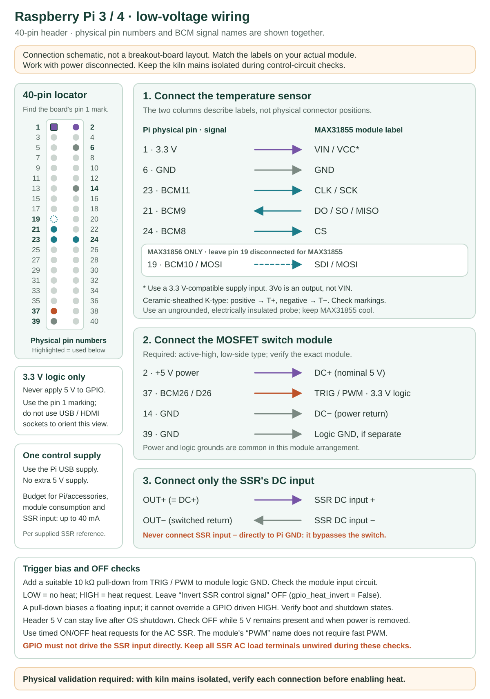
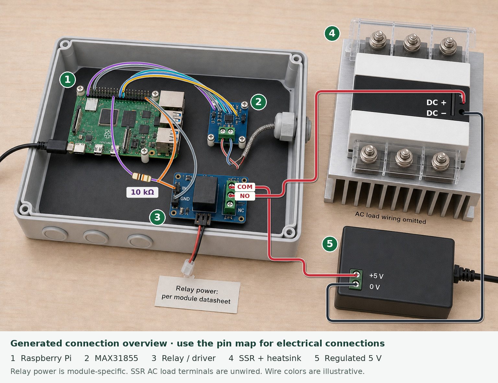

# Build with Raspberry Pi 3 or 4

[README](../../README.md) · [Parts](../PARTS.md) · [Board status](../supported-boards.md)

**Status: software profile available; physical Raspberry Pi validation pending.**
This walkthrough has a matching installer and pin profile, but it has not been
commissioned on a real Pi/driver/kiln combination. Start with simulation. The
[Orange Pi guide](../INSTALL.md) describes the existing hardware deployment.

**No Raspberry Pi yet?** You can still [try the dashboard on a Linux computer or
in Ubuntu on Windows](../GETTING-STARTED.md#try-it-before-buying-parts). Read the
steps below to understand the eventual build before buying parts.

The initial profile accepts **Pi 3 Model A+, 3 Model B, 3 Model B+, and Pi 4 Model B**
with a 40-pin header. Pi 4B is the proposed first validation build. It does not
accept Pi 5, Pi 400/500, Compute Modules or Zero-family boards; those need separate
model/backend checks. The proposed OS is **Raspberry Pi OS Lite, 64-bit, Debian 12
(Bookworm), Python 3.11**. Record the exact image and package versions during
physical validation; software tests on a Linux computer do not verify this OS image.

> Work on the low-voltage controller with power disconnected. Keep kiln mains
> isolated throughout software, sensor and output checks. A qualified electrician
> must complete and verify the kiln power and independent safety circuit.

## 1. Prepare the SD card and connect

You need the [listed parts and tools](../PARTS.md), a computer with an SD reader,
and access to the same local network as the Pi. Start with the board, SD card and
board power supply only; leave the driver and kiln power disconnected.

[](../images/hardware/raspberry-pi-parts-generated.jpg)

*Generated illustration of the board-preparation and sensor parts. Component
appearance varies; use the parts table and your module's markings. The output
driver and kiln power components are selected separately.*

**Parts shown:** **1** Raspberry Pi; **2** microSD card and reader;
**3** USB-C power supply; **4** MAX31855 sensor converter; **5** K-type
thermocouple; **6** jumper leads; **7** mounting spacers.

1. Install [Raspberry Pi Imager](https://www.raspberrypi.com/software/) on your
   computer. Select your exact Pi model. For the **Bookworm 64-bit Lite** image
   used by this guide, download
   `2025-05-13-raspios-bookworm-arm64-lite.img.xz` from the
   [official Raspberry Pi image archive](https://downloads.raspberrypi.com/raspios_lite_arm64/images/raspios_lite_arm64-2025-05-13/).
   In Imager's operating-system chooser, select **Use custom** and choose the
   downloaded `.img.xz` file; you do not need to unpack it. This selects Debian 12
   even if Imager's default is a newer release. The image is a setup target, not
   a physically validated installation of this project.
2. Select the SD card carefully: writing the image erases the selected card.
3. Set a hostname such as **kilnpi**, create your own username/password, configure
   Wi-Fi/country if needed, and enable SSH (remote terminal access). Wired Ethernet
   can simplify the first connection on boards that provide it.
4. Write the image, eject the card, insert it into the unpowered Pi, connect the
   network and correct power supply, and allow first boot to finish.
5. Open **Terminal** on macOS/Linux, or **PowerShell/Windows Terminal** on Windows.
   Connect using the username you created. For an example username `maker`:

   ```bash
   ssh maker@kilnpi.local
   ```

   Substitute your actual username/hostname. On the first connection, compare
   the host identity through your trusted local setup before accepting it, then
   enter the password. Password typing may not show characters.

**Check:** the terminal prompt belongs to the Pi. Run:

```bash
cat /proc/device-tree/model
cat /etc/os-release
python3 --version
hostname -I
```

You should see the intended model, Debian 12-based Raspberry Pi OS, Python 3.11,
and the Pi's address. The installer checks model identity before hardware setup.

**If `.local` does not work:** find the Pi in your router's connected-device list
or on an attached local screen, then use `ssh maker@<Pi-IP-address>`. Replace the
placeholder; do not type the angle brackets. A wrong username or Wi-Fi setup
must be resolved before installing the controller.

## 2. Install and open the preview

These commands now run **on the Pi**, as your normal user:

```bash
sudo apt update
sudo apt install git
git clone https://github.com/tamirgold/kiln-controller.git
cd kiln-controller
bash setup.sh --board raspberry-pi
```

The installer prepares Python, the Raspberry Pi dependencies and GPIO access. It
creates local settings only if absent: simulation is on, recovery is off and
the initial control cycle is 30 seconds. It does not configure or start a service.
It does not decide the output polarity for your driver.

Log out with `exit`, reconnect through SSH, then:

```bash
cd kiln-controller
KILN_BOARD=raspberry-pi bash scripts/run-simulation.sh
```

Open `http://kilnpi.local:8081/picoreflow/index.html` on a phone/computer on the
same network. Use the Pi's IP if the name does not resolve.

**Check:** the page identifies a simulated kiln. Try a sample schedule to learn
the controls. The preview does not use real GPIO; successful simulation does not
prove the sensor or relay is connected correctly. End the simulated firing and
press Ctrl+C in the SSH terminal before continuing.

**If installation fails:** keep the first error, verify your OS/model and review
the [development/setup notes](../DEVELOPMENT.md). Do not force Blinka to identify
the Pi as an Orange Pi. GPIO imports use the real board identity.

## 3. Connect the low-voltage parts

Disconnect all controller power before assembly or wiring.

[](../images/hardware/raspberry-pi-assembly-generated.jpg)

*Generated assembly illustration: arrange and secure the low-voltage parts
before wiring. The output-interface space is left open because its exact module
determines its mounting and connections. Follow the pin table below for wiring.*

**1** Raspberry Pi · **2** Sensor converter · **3** Space for the chosen output interface.

1. Test-fit the Pi so its power, network and USB ports and microSD slot remain
   accessible. Allow the cooling clearance required by your board and enclosure.
2. Secure the Pi and converter through their own mounting holes on correctly
   sized insulated standoffs. Use the actual board holes, not the generated
   image, as the drilling template. Keep their
   undersides clear of the mounting plate and loose metal, and leave the headers
   and sensor terminals accessible. Position the converter away from the Pi's heat.
3. Plan strain-relieved cable entries and leave space for the chosen output
   interface. Route the thermocouple cable separately from power wiring; keep
   everything unconnected until you have checked each module's markings.

Locate **pin 1 from the board's marking**. Use the schematic and pin tables below
for every electrical connection; the generated illustration shows placement
only. The diagram is a schematic and pin locator; it is not a photograph of a
verified assembly. A board's orientation on your bench can differ.

[](../images/hardware/raspberry-pi-wiring.svg)

### Temperature sensor

| Physical Pi pin | GPIO / software name | Connect to |
| ---: | --- | --- |
| 1 | 3.3 V supply | Compatible MAX31855 VIN/VCC |
| 6 | Ground | MAX31855 GND |
| 23 | BCM11 / `D11` | MAX31855 CLK/SCK |
| 21 | BCM9 / `D9` | MAX31855 DO/SO/MISO |
| 24 | BCM8 / `D8` | MAX31855 CS |
| 19 | BCM10 / `D10` | Leave unconnected for MAX31855; MOSI/SDI for MAX31856 |

This profile uses **software SPI** (the application drives these signal pins);
you do not need to enable a separate hardware SPI overlay for this route. Keep
other processes from using the same pins. Physical pin numbers are not BCM
numbers: physical 23 is BCM11, not BCM23.

Connect an **ungrounded, electrically insulated K-type thermocouple** to T+ and
T−. Use the correct type-K extension cable/connector. Keep the probe insulated
from elements and the converter away from the hot chamber and mains wiring.
Module markings govern: on Adafruit breakouts **3Vo is an output**, not VIN.

### Heat-request output

| Physical Pi pin | GPIO / software name | Connect to |
| ---: | --- | --- |
| 37 | BCM26 / `D26` | Compatible 3.3 V driver input |
| 39 | Ground | Driver input reference where required by its schematic |

The output must go through a verified compatible interface. Do not connect the
documented up-to-40 mA SSR input directly to GPIO. The [parts guide](../PARTS.md#choose-the-output-interface-deliberately)
explains what to establish before buying a driver.

For a **3.3 V-compatible active-low relay** matching the
[documented example](../HARDWARE.md#4-connect-the-relay-and-ssr-input), connect
**physical 37 / BCM26 to IN1** and **physical 39 to relay input logic GND**.
HIGH means no heat request; LOW requests heat. Its dry contacts switch a
separate regulated 5 V supply into the **3–32 VDC SSR control input**:

[](../images/hardware/raspberry-pi-wired-assembly-generated.jpg)

*Generated assembly with a wiring overlay. Use the pin and connection tables as the
electrical reference; actual module layouts vary. The SSR's AC load terminals
are shown unwired.*

**1** Raspberry Pi · **2** MAX31855 · **3** Relay/driver ·
**4** SSR and heatsink · **5** Regulated 5 V SSR-control supply.

| From | To |
| --- | --- |
| Pi physical 17 / 3.3 V, through an optional 10 kΩ pull-up if required by the module | Relay IN1 |
| Separate regulated control supply +5 V | Relay COM |
| Relay NO (normally open) | SSR DC control input + |
| Control supply 0 V | SSR DC control input − |
| Relay NC (normally closed) | Leave unused |

Power the relay's logic and coil according to its **exact module schematic**;
VCC/JD-VCC connections and jumper positions are module-specific. The SSR-control
supply's 0 V stays separate from Pi logic GND in this dry-contact example.
The optional pull-up biases IN1 off only while the Pi's 3.3 V rail exists.
Relay contacts carry the SSR's low-voltage control current, not kiln mains.

Mount the finished low-voltage assembly securely, with labeled cables, strain
relief and separation from power wiring. Do not treat loose bench jumper wires
as the finished kiln enclosure.

## 4. Check sensing, polarity and OFF behavior

Kiln mains remain isolated. Reapply only the appropriate controller/low-voltage
power. Stop all controller processes before the sensor-only test:

```bash
KILN_BOARD=raspberry-pi KILN_SIMULATE=0 \
  timeout 15 venv/bin/python -u test-thermocouple.py
```

**Check:** the converter reports a plausible room temperature and reacts when
the probe is gently warmed. This command reads real hardware even if your saved
settings select simulation. It does not intentionally operate the heat output.
`timeout` ends it after 15 seconds (exit status 124 is expected at the timeout).
Resolve sensor faults before proceeding.

Next open a commissioning session that uses the normal local settings. A new
install's local settings still select simulation:

```bash
KILN_BOARD=raspberry-pi venv/bin/python kiln-controller.py
```

Review **Settings → Sensor & wiring**. Match every pin to the table and set
**Invert SSR control signal** according to the actual driver:

- Active-high: leave it off; LOW is the no-heat level.
- Active-low: enable it; HIGH is the no-heat level.

Review the control cycle for the driver. The initial 30-second cycle is intended
to avoid rapid mechanical-relay switching, not to certify a particular relay.
Leave recovery and all protection overrides disabled during commissioning.
Save, review, and apply while idle. A terminal-launched process exits on apply;
rerun the same command to load the saved values.

Before allowing real heat, verify with mains isolated:

1. With simulation turned off and a ready sensor, an idle controller requests
   no heat and the driver/SSR input agrees.
2. Start/stop a suitable bench test only as part of a planned output check;
   establish which electrical levels turn the request on and off.
3. Confirm the output is off during boot, shutdown and controller power loss
   **while the driver/SSR supply stays energized**.
4. Confirm a disconnected/faulted sensor prevents heating and produces a fault.

The service and software OFF calls are useful checks, not a substitute for
hardware that fails off. An SSR LED only indicates its control input. Never use
the general output-toggle script as a routine check on a powered kiln.

## 5. Complete the power installation and optional service

Have the electrician verify the kiln's power circuit, protective earth, SSR
cooling, isolation, stop/interlock chain and independent temperature limiter
with its own sensor and manual reset. The [power diagram](../HARDWARE.md#5-understand-the-three-phase-power-path)
is conceptual; use actual nameplate and installation ratings.

After reviewing the wiring and OFF checks, generate a service for your actual
username, path and board. Stop the terminal controller first. This command
**only creates a file for review**:

```bash
mkdir -p storage/installation
python3 scripts/create-service.py --board raspberry-pi --mode hardware \
  --commissioned --output storage/installation/kiln-controller.service
cat storage/installation/kiln-controller.service
```

Check its `User`, `WorkingDirectory`, executable paths and `KILN_BOARD`. Install
it only for this commissioned build:

```bash
sudo install -m 0644 storage/installation/kiln-controller.service \
  /etc/systemd/system/kiln-controller.service
sudo systemctl daemon-reload
sudo systemctl enable --now kiln-controller
sudo systemctl status kiln-controller --no-pager
```

The hardware-capable unit follows your saved Simulation setting. Keep that on
until you are ready for the final checks; it does not force real operation.
When idle, disable simulation through Settings, review/save/apply, and verify
fresh real sensor readings and no heat request before a firing.

## 6. Commission a first firing

Set the actual kiln power, tariff, temperature limit and suitable control
settings. Default limits and PID gains are examples, not calibration results
for your kiln. Choose a supervised commissioning program suitable for the kiln
and load, and follow the electrician's test plan.

**Check:** heating stops when commanded, measured temperature behaves as
expected, independent trips work as designed, SSR operating temperature stays
within its cooling design, and the saved firing record is credible. Review
[control and recovery](../CONTROL.md) before enabling automatic restart.

Record the Pi model, OS image, package versions, exact parts, wiring and test
results in a [build report](../supported-boards.md). A completed physical report
is required before this guide can be labeled a validated Raspberry Pi build.

For everyday operation, see [Using your kiln](../USER-GUIDE.md). For changes to an
existing controller, use [Maintenance](../MAINTENANCE.md) and update only while
the kiln is idle.
